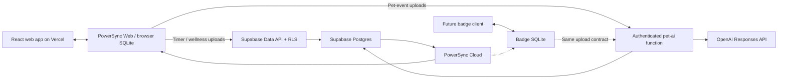

# Badgegotchi

A focus timer and pet companion for the web, ported from Pomogotchi.
The React app in [`web/`](web/README.md) uses the PowerSync Web SDK and is prepared
for Vercel. Browser SQLite stores timer and wellness actions locally and syncs
with Supabase. Pet reactions run in a Supabase Edge Function using OpenAI; the
browser does not hold a model or OpenAI key.

## Run the React app

```sh
cd web
npm ci
cp .env.example .env.local
# Set the public Supabase URL/key and PowerSync URL in .env.local.
npm run dev
```

The development checkout already has an ignored `web/.env.local` populated with
public client configuration. See [web setup and deployment](web/README.md) for
Vercel settings, sign-in email templates, and PowerSync DevTools. The development
Supabase backend accepts `web` pet event sources as of October 20, 2026.

## Architecture



Each browser stores a local database per account. Daily counts are derived from
activity records instead of uploading competing cached totals. Supabase Auth
supplies the identity for both uploads and PowerSync's owner-filtered streams.
The server owns pet creation, event claims, and reaction results.
See [architecture and tradeoffs](docs/architecture.md).

## Cloud services

- Supabase project: `bfccerfayrfolisawokp`.
- PowerSync instance: `6ad76c8f2f27853eb0b0a128`.
- The PowerSync dashboard label is `Production`; the project owner explicitly
  identified this instance as a development target for this work.
- The existing replication connection and owner-filtered streams are reused.
- Supabase auth is enabled on PowerSync.
- Database setup is in `supabase/migrations/`.
- The `pet-ai` Edge Function validates a Supabase user JWT and holds the OpenAI key.

Set server secrets in Supabase:

```sh
supabase secrets set --project-ref bfccerfayrfolisawokp --env-file /path/to/server.env
supabase functions deploy pet-ai --project-ref bfccerfayrfolisawokp --use-api
```

`server.env` should contain `OPENAI_API_KEY` and, optionally, `OPENAI_MODEL`.
The default model is `gpt-4.1-mini`. Use a restricted OpenAI project key with
**Responses API Write** (`api.responses.write`); other permissions are unnecessary.
The function uses `store: false`, bounded output, a timeout, and per-owner limits.

The downloaded `powersync/service.yaml` is ignored because it may contain
connection configuration. Retrieve it with the CLI when needed:

```sh
npx --yes powersync@0.10.2 pull instance --instance-id=6ad76c8f2f27853eb0b0a128
npx --yes powersync@0.10.2 validate
```

Pulling overwrites local PowerSync configuration. Save local edits first.

## Verification

```sh
cd web
npm test
npm run build
cd ..
deno task --config supabase/deno.json test
```

See [browser verification](web/README.md#verify) for Playwright commands covering
the development server and production build. Browser tests use real PowerSync
SQLite workers with mocked cloud endpoints; they do not validate live replication,
the deployed `pet-ai` function, or OpenAI inference. SQL assertions in
`supabase/tests/pet_ai.sql` run inside a transaction and roll back.

## Scope

The app provides the 40-minute focus timer, 10-minute breaks, wellness
logging, daily totals, original animal artwork, and cloud pet reactions.
Badge firmware integration is separate from the web app. Initial
pet names and biographies are currently deterministic; event reactions are
AI-generated.

Source UI, animal assets, timer logic, and tests were ported from the sibling
Pomogotchi repository. The repository license remains in [LICENSE](LICENSE).
