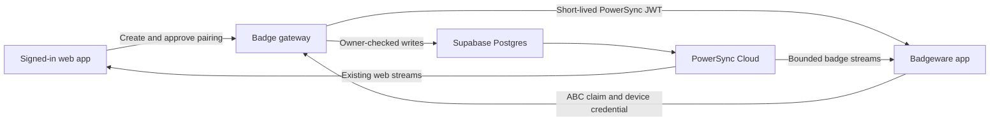

# Handoff: pair a Badgeware badge and sync it with the web app

Prepared 2026-10-20. This document describes the next implementation; it does
not claim that pairing or live badge sync already works. No device, cloud
configuration, or deployment was changed while preparing this handoff.

## Goal and explicit user requirements

Connect the installed Badgegotchi Badgeware app to the existing account and
PowerSync data used by the web app. Provide an authenticated **Pair a badge**
UI in the web app. The web app displays a pairing code composed **only of A,
B, and C**, and the user enters it by pressing those physical badge buttons.
**Do not build an on-screen keyboard or require typing an email, password, or
alphanumeric code on the badge.**

Keep the existing Badgeware firmware, launcher, other apps, settings, and data.
Report exact blockers before proposing firmware changes. Preserve the current
timer behavior: B starts/pauses; Home retains a running timer and reopening
accounts for elapsed badge-clock time. The app cannot sync or alert while the
launcher or another app owns the VM; it catches up when reopened.

User rules still apply: never `git push`; never blanket-stage files; use distinct
local branches if work is split into PRs; no deployment to the powersync Vercel
organization without approval. This handoff is not deployment authorization.

## Start from this verified baseline

Repository: `/Users/kobie/projects/powersync/skunkworks/badgegotchi`.
The current chat's working directory is the sibling `powerbadge` directory;
set the working directory explicitly. There is substantial uncommitted app and
installer work: inspect `git status`, preserve it, and do not reset/clean it.

| Component | Existing state and source |
| --- | --- |
| Installed app | `0.1.0-alpha.2`; [app documentation](../../badge/README.md), [device qualification](../../badge/evidence/qualification-alpha2.md) |
| Package | `badge/dist/badgegotchi-0.1.0-alpha.2-a03391f5a485.zip`; SHA-256 `a03391f5a48549138a1591489266365ccde288b0f51045d00c818af9994d7111` |
| Runtime | Tufty 2350; MicroPython 1.29.0; exact build `bw-1.29.0-gc,   on 2026-09-22 (GNU 13.3.1 MinSizeRel)`; `_mpy=7942`; qualified softfp native ABI |
| Native core | SQLite 3.54.1 plus real PowerSync `0.5.4/cratesio`; [native wrapper](../../badge/native/module.c), [build notes](../../badge/native/README.md) |
| Badge storage | [Store/VFS](../../badge/app/badgegotchi/badgegotchi_storage.py): one `local_only` `badge_state` row, schema version 2; `/state/badgegotchi/state.sqlite`; no account identity or transport |
| Browser | [schema](../../web/src/lib/schema.ts), [connector](../../web/src/lib/connector.ts), [domain commands](../../web/src/domain/repository.ts), [timer rules](../../web/src/domain/timer.ts) |
| Cloud | Supabase project `bfccerfayrfolisawokp`; PowerSync Cloud instance `6ad76c8f2f27853eb0b0a128`, project `6ad76c8e02e1e50007a3552a`; [CLI link](../../powersync/cli.yaml) |
| Backend contracts | [base migration](../../supabase/migrations/20261020162510_badgegotchi_cloud_sync.sql), [web event source migration](../../supabase/migrations/20261020170338_pet_events_web_source.sql), [pet-ai handler](../../supabase/functions/pet-ai/handler.ts) |
| Download config | [five edition-3 streams](../../powersync/sync-config.yaml), all currently `auto_subscribe: true` and filtered by `owner_id = auth.user_id()` |
| Installation | Public `/install` copies an ordinary app directory using browser File System Access or a ZIP. It does not pair accounts. [Installer contract](../badge-installer.md) |

The README records that the instance labeled **Production** was identified by
the owner as a development target. Verify that recorded target before any cloud
mutation; do not infer fresh authorization to change service authentication.
Use the existing public client configuration without printing secrets. Do not
pull PowerSync configuration over local edits; `pull instance` overwrites files.

The installed native module, local persistence, real core checkpoint fixture,
and app-copy workflow passed device tests. Live PowerSync streaming, device
authentication, and verified HTTPS **inside the installed Badgeware app** have
not passed. The separate `powerbadge/native/sqlite-hello/powersync/networking/`
experiment demonstrated public HTTPS with temporary standalone firmware; that
does not establish compatibility with the current Badgeware runtime.

## Pairing experience

Keep **Set up a badge** / `/install` available for installation. Add **Pair a
badge** to the signed-in dashboard or account/device area, with a link to install
first if needed. Pairing is an online account operation; do not enqueue it as an
ordinary offline PowerSync row write.

Proposed initial flow:

1. The signed-in user selects **Pair a badge**. The server creates an owner-bound,
   expiring pairing session. The browser displays twelve random button symbols,
   grouped for readability, for example `A C B · B A C · C A A · B C B`.
   Show expiry, **New code**, and **Cancel**, plus a diagram matching physical
   A/B/C positions. Render letters as text; color alone must not carry meaning.
2. The unpaired badge offers **Pair / Continue offline**, and pairing remains
   reachable later through its app menu. In pairing mode, each physical A/B/C
   press appends exactly one symbol, with visible progress such as `5 / 12`.
   Require release before another symbol; holding a button never repeats it.
   Auto-submit at twelve symbols. Home cancels safely. Offer a clear retry state
   after an incorrect/expired code. A/B/C input must not also pet/start/log water.
3. The badge claims the session using the entered sequence and a separate
   high-entropy pending-device secret. Both screens show a matching verification
   identifier derived from that claim. The web user explicitly confirms the
   badge whose identifier matches the badge screen; a guess of the short code
   must never silently authorize a device. Displaying an identifier requires no
   keyboard input on the badge.
4. After confirmation, only that pending badge's credential becomes authorized.
   Use the recoverable enrollment protocol below; retry safely if the reply
   is lost. The browser can offer an optional badge name using its normal text
   input. Distinguish **Paired**, **Connecting**, and **Synced**. The last state
   requires a real completed PowerSync checkpoint, not an HTTP 200 or token.
5. List paired badges with name, last contact/sync time, and **Unpair**. Last
   contact is historical, not proof that the device is currently online. Cancel,
   sign-out, refresh, expiry, and retry must leave intelligible UI states.

Twelve symbols, five-minute expiry, and attempt limits are proposed defaults,
not protocol facts. `3^12 = 531,441` possibilities (about 19 bits), so the code
is a rendezvous aid, **not a password, refresh token, or authentication token**.
Generate it using a cryptographic RNG with collision-safe allocation among
active sessions. Store a keyed digest, keep it out of logs/URLs/analytics, allow
only atomic one-use approval, and invalidate the old code when regenerated.
Enforce bounded claims/attempts and device, IP, account, and aggregate rate limits;
an attacker can invent device IDs, so per-device limits alone are insufficient.
Test that guessed codes cannot skip the authenticated confirmation/matching step.

Wi-Fi setup is a separate prerequisite. First investigate reuse of Badgeware's
existing network configuration through its normal APIs without logging or
overwriting credentials. If unset, show a Wi-Fi-needed path. If browser-assisted
provisioning is needed, design it separately with private per-device data; do not
put Wi-Fi credentials into the public app package or pretend an ABC code encodes
them. Do not quietly replace this pairing flow with a badge keyboard.

## Recommended authentication and backend design

The following is a proposed device gateway, not an existing endpoint contract.

Use a dedicated revocable device credential, resolved server-side to an active
badge registration and owner. Do not copy the browser's Supabase refresh token
to the badge, create a second user account per badge by default, or trust an
`owner_id` supplied in a device request.

Implement separate authenticated responsibilities, whether grouped into one
function or several:

| Operation | Authentication and required behavior |
| --- | --- |
| Create/status/cancel/approve pairing; list/rename/revoke badge | Existing Supabase user session; explicit ownership checks; approval binds one exact pending claim |
| Submit ABC sequence | Unpaired bootstrap request; strict bounds/rate limits; high-entropy pending secret and candidate device credential digest, independent of the code |
| Poll approved claim / acknowledge enrollment | Proof of pending secret over verified TLS; return registration/activation metadata only; recoverable, bounded delivery retry |
| Refresh badge credentials / obtain PowerSync credentials | Active device credential; rotation/revocation and retry policy; return endpoint, short-lived token and expiry |
| Upload app mutations | Active device credential; server derives owner, validates allowlisted tables/fields, atomically records durable acceptance with idempotency |

Use server-only storage for pairing sessions, pending secrets/digests, credential
digests, and upload receipts. If the browser needs device metadata, expose only
safe fields through an owner-checked API or separately reviewed RLS table. Do
not add secrets to the replication publication, PowerSync streams, ZIP, browser
bundle, screenshots, or evidence. Model pending → approved → delivered/revoked/
expired transitions atomically; duplicate requests must not create extra devices.

For recoverable enrollment, have the badge generate and durably persist two
independent 256-bit random secrets **before** claiming: a pending-request secret
and its candidate device credential. Store them in app-owned private `/state`
storage, never the USB-visible app directory. The claim registers credential
digests; approval activates the exact candidate. Polling returns registration
metadata, and the badge proves the active credential before acknowledging
enrollment. A lost response or reset can retry with the same persisted values;
the server never needs to reconstruct a random credential from its digest.
Credential rotation likewise needs a pending/confirmed protocol that never
discards the only usable credential after an ambiguous reply. Qualify interrupted
credential writes under the same filesystem limitations as app data.

For downloads, the proposed broker signs short-lived PowerSync JWTs with the
existing owner's ID as `sub`, plus trusted device identity/scope claims. Configure
their issuer/JWKS/audience deliberately, preserving existing Supabase browser
authentication. [PowerSync supports custom JWT authentication](https://docs.powersync.com/configuration/auth/overview);
this proposal requires a reviewed **service-auth configuration change** before
deployment. It is not accomplished by changing only `sync-config.yaml`. Never
ship a token-signing key in the badge. Validate the exact accepted token contract
against the target instance before wiring up the client.

The current REST/RLS path uses a Supabase user JWT, and `pet-ai` calls
`/auth/v1/user` to validate its bearer token. A custom badge token or PowerSync
JWT is not automatically accepted by either. Implement an explicit device-auth
gateway and shared internal business logic; do not simply disable `pet-ai` JWT
checks. If a new Edge Function cannot use platform Supabase JWT verification,
give that function its own complete authentication boundary. Privileged server
DB access must enforce ownership, field restrictions, and active-device checks.

Revocation immediately stops gateway uploads and credential renewal. Already
issued download JWTs can remain valid until expiry; measure and state that
window, and do not promise immediate remote erasure of an offline badge. Local
unpair/account change must quarantine old-owner pending writes and cached data;
never upload them under the next owner. Provide an explicit export/discard policy
before deleting unsynced progress. Web sign-out alone need not unpair a badge.

## Shared data, migration, and conflict rules

Use the existing row contracts rather than syncing the badge's aggregate JSON
snapshot into the web tables:

| Badge action/state | Shared contract |
| --- | --- |
| Focus/break start, pause, resume, finish | `sessions`; stable UUID, UTC timestamps/day key, `active`/`paused`/`ended`, seconds rather than badge milliseconds |
| C: water | Append `wellness_events.type = hydration`; matching `drink_water` pet intention where appropriate |
| Up: stretch | Append `wellness_events.type = movement`; matching `move_or_stretch` intention |
| A: pet | Append `pet_events.event_type = pet_pet`, `source_device = badge`, current server-owned pet session ID |
| Pet appearance/name/speech | Read synced `pet_sessions` and `pet_events`; clients do not author server reaction results |
| Daily totals | Derive from canonical activity records or an explicitly maintained server projection; never overwrite with local aggregate counters |

`badge` is already accepted as a pet-event source. Preserve the existing
40-minute focus and 10-minute break rules, UTC day boundaries, and paused next
phase after completion. Keep using the badge clock to restore elapsed time
after Home, but represent paired timer changes with the shared session model.

Before changing schema, back up and inspect the owned database. It currently
rejects unknown filenames/schemas and any nonempty `ps_crud`; that last check
must change deliberately for synced tables. Design an account/device-bound
migration, credential file allowlist, retry metadata, and schema version. Keep
the old local snapshot as an explicit legacy record. Aggregate pet/water/stretch
counts have no event IDs or timestamps: do not invent historical events or
silently merge them into a cloud day. Preserve them visibly as pre-pairing local
progress unless a separate explicit import is designed. An in-progress local
timer also needs an explicit continuation/adoption rule when the account already
has an active session; do not silently reset either timer.

A bounded recent-event cache cannot produce complete daily totals. The current
web app derives counts from raw rows; the existing daily-summary counts are not
an authoritative server-maintained rollup. Add such a rollup for the badge or
label its counts as window-limited. Also reconcile the metric: web
`ended_focus_count` includes completed and stopped sessions, whereas the alpha
badge's `focus_count` increments only on completion. Define consistent labels
and semantics without changing the meaning of retained legacy totals.

Define cross-device conflict behavior before declaring timer parity. Current
web commands use ordinary PUT/PATCH writes; local transactions do not serialize
two offline devices. Starting sessions concurrently can leave multiple active
rows, and the browser's latest-started query merely hides that ambiguity. Two
devices can also generate different random pet-event IDs for one completion.
Specify server reconciliation for concurrent starts and stale pause/resume/end
mutations, and stable session-transition idempotency for completion reactions.
Update the web writer too where required; fixing only the badge is insufficient.
In particular, stale partial updates can resume a row without clearing its old
`ended_at`/`outcome`, and current pet intentions carry a pet-session ID rather
than a timer-session ID. Transition deduplication therefore needs an explicit
validated identity/contract, not just another random event UUID. There are no
`pause_break`/`resume_break` pet-event types today; break pause/resume changes
the session without inventing new enum values.

The existing browser connector uploads operations sequentially and can retry
after partial server success. It is not proof of atomic whole-batch acceptance.
The proposed badge upload contract should durably accept a whole bounded local
transaction with a stable device/owner-scoped idempotency key and payload digest.
Return the same acceptance on a lost-response retry; reject key reuse with a
different payload. Do not acknowledge unauthenticated, rejected, partial, or
ambiguous writes. A permanent validation error needs a visible resolution policy,
not silently dropped data or an infinite retry loop.

Pet inference currently runs during upload and can delay later writes. Separate
durable pet-intent acceptance from slow inference for the badge path, reusing
existing event/lease/idempotency logic and a real retry worker. Do not require
an OpenAI response to keep the device upload queue moving. AI can follow the
first timer/wellness round trip; this milestone is shared data and pairing.

## Storage and network gates before live sync

These are known constraints or unqualified areas, not evidence that firmware
replacement is necessary:

1. **Bound the download set.** The badge DB limit is 128 KiB, the native arena
   256 KiB, query output at most 32 rows, and the VFS reserves shared state space.
   Five auto-subscribed owner-history streams can exceed this quickly, including
   oplog/checkpoint overhead. Omitting client tables is not a size control: data
   can still land in `ps_untyped`. Measure current account size before connecting.
2. **Design badge-specific streams/projections.** Start with the current pet,
   active session, and bounded recent activity. Prevent badge tokens from also
   receiving the existing full-history auto streams, while preserving browser
   behavior. Use trusted auth claims for authorization; client subscription or
   connection parameters cannot grant access. [Stream parameters](https://docs.powersync.com/sync/streams/parameters)
   can select a bounded subset within the authorized owner. Prove the exact
   query syntax and core 0.5.4 subscription support; do not assume `LIMIT` or a
   moving time filter is supported. Today-only data is not inherently bounded
   without an event/rate policy. Keep full history server-side; do not delete
   cloud records merely to fit the badge.
3. **Qualify the installed network stack.** Inspect Badgeware's `network`,
   socket, TLS, DNS, timeout, and cancellation APIs. Verify CA chain, hostname,
   certificate dates, entropy, and clock handling before sending credentials.
   Never fall back to `CERT_NONE`. Test the actual Supabase/gateway and PowerSync
   hosts, reconnect, and non-success HTTP responses. Supabase announced removal
   of selected TLS 1.2 CBC suites from November 10, 2026 at the earliest; verify
   a supported AEAD suite or TLS 1.3 ([notice](https://supabase.com/changelog/cbc-tls-ciphers-deprecated)).
4. **Respect the measured persistence limitation.** Nonempty startup journals
   currently fail closed because file truncation/recovery is unqualified.
   Expanded replication, deletion/compaction, interrupted transactions, and
   queue growth need their own tests. Retain failed DBs/journals for diagnosis.
   Do not add VACUUM, WAL, automatic repair, a second mount, or raw-flash writes
   to bypass this constraint. If the required workload cannot work, report the
   precise failing operation before discussing firmware options.
5. **Keep the UI and Home responsive.** Use one DB owner and bounded cooperative
   network steps; no SQL/network calls in IRQs and no open SQL transaction while
   waiting for HTTP. Measure combined TLS/core/Python memory and worst-case pause
   time against the existing 16-second watchdog. Home must cancel network work,
   finish/roll back the current transaction, save, close, and return normally.

## Implement the actual PowerSync client lifecycle

The `.mpy` provides the real core, not a complete MicroPython SDK. Add a transport
supervisor around the pinned `powersync_control` API, including credentials,
stream opening/closing, framing, status, upload coordination, and reconnect.
Use the real service's response and checkpoint protocol; never transplant the
feasibility fixture's hardcoded bucket/checkpoint values into product code.
PowerSync downloads come from the sync service, while application writes go to
the backend ([client architecture](https://docs.powersync.com/architecture/client-architecture)).

Useful local references:

- [Real core fixture](../../experiments/badgeware-native/powersync-audit/fixture.py)
  and [feasibility report](../../experiments/badgeware-native/README.md).
- [Sibling reference adapter](/Users/kobie/projects/powersync/skunkworks/powerbadge/native/sqlite-hello/powersync/networking/host/README.md).
  Its C adapter tests use the real core with a mock backend. Port its contracts
  and adversarial tests, not its fake service responses or standalone scheduler.
- [Protocol overview](https://docs.powersync.com/architecture/powersync-protocol);
  consult the pinned upstream core/SDK implementation for exact wire calls.

Process all returned core instructions, including token refresh, stream closure,
checkpoint requests, and completion. Tag async replies with connection generation
and identity so stale replies cannot mutate a new session. Bound NDJSON/HTTP
framing across arbitrary read boundaries, preserve backpressure, and fail cleanly
on oversized/truncated input. Keep checkpoint IDs as decimal strings or exact
64-bit integers, not JavaScript-style floating-point numbers.

Persist one captured upload transaction and its retry identity before sending.
Remove only the accepted captured queue range; later local writes survive.
Distinguish backend acceptance, local queue acknowledgment, core notification,
service write checkpoint, and server echo. Prove that a download cannot overwrite
an unacknowledged local mutation. Expose last completed sync, pending count, and
actionable offline/auth/storage errors without exposing tokens.

## Suggested implementation order and acceptance

1. **Preflight and contracts:** read this handoff and qualification reports,
   verify target IDs, inspect installed network APIs, measure storage headroom,
   and specify the shared-data/conflict/legacy-import policy. Record blockers
   first. Use existing PowerSync/Supabase tooling; preserve local config edits.
2. **Backend pairing and auth:** implement migrations, bounded pairing state
   transitions, owner management, credential issuance/rotation/revocation,
   idempotent upload acceptance, and bounded stream authorization. Review the
   concrete service-auth/config diff and intended target before deployment.
   Verify backend readiness before connecting the real client.
3. **Web and badge pairing UI:** add the signed-in action/device list and physical
   ABC-entry state machine. Test the complete approval and retry flow with a
   simulated device, then on unchanged Badgeware. Keep installation separate.
4. **Small real sync round trip:** migrate an owned test database, receive one
   real authorized row through PowerSync, upload one badge wellness event, and
   observe it in the existing web app through its PowerSync database. Change a
   session in the web app and observe it on the badge. No mock transport counts
   as this acceptance gate.
5. **Lifecycle and product coverage:** test timer conflicts, pet intentions,
   offline writes, reset/reopen, token expiry, unpair, and account isolation.
   Finish capacity/backpressure/error UX before expanding the download window.
6. **Release:** rebuild/hash/pin any changed native binary, run the app/package
   checks, create a new versioned ZIP/static manifest, and use a checked update
   with backups. Repeat preservation fingerprints and physical Home/launcher
   checks. Document exactly what passed; publishing remains a separate action.

Required evidence includes:

- Pairing: only A/B/C input; held-button suppression; expiry, wrong code,
   cancellation, regeneration, concurrent claims/approvals, lost delivery reply,
   guessing/rate limits, and restart during enrollment. Only the approved pending
   credential becomes authorized; no keyboard or copied browser session is needed.
- Authorization: account A cannot approve/revoke/read/write B's badge/data;
   forged owner/device claims and client-controlled stream parameters fail;
   secrets never enter replication; revocation blocks uploads/renewal and the
   download-token expiry window is measured.
- Sync: actual badge → backend → PowerSync → web and web → PowerSync → badge;
   offline/reset/reconnect retries preserve stable IDs and produce no duplicate
   wellness actions, completion reactions, or premature checkpoint acknowledgment.
- Failure/capacity: bad certificates, missing clock, truncated/oversized streams,
   stale responses, rejected/partially accepted uploads, large account history,
   full storage, retained journals, and AI outage preserve pending work.
- Preservation: legacy progress survives migration; Home still accounts for time
   away; launcher/buttons/other apps work; firmware is unchanged. Pairing and
   successful network auth alone must not be reported as successful sync.

This handoff's code inspection is current to the checkout above. Cloud readiness,
current credentials, endpoint behavior, and networking under Badgeware must be
verified during implementation; they were not exercised for this document.

## Preflight follow-up — 2026-10-20

The [preflight report](../../experiments/badge-pairing-preflight/README.md)
records unchanged-firmware HTTPS checks, live cloud diagnostics, stream
authorization tests, preserved data and the proposed shared-data contracts.
Pairing and live sync are still unimplemented. Credential entropy, the
ordinary-schema arena limit, native full-capacity failure and device
persistence remain gates. The host native stress fixture caused Python
crash dialogs; no stress processes remain running. Do not repeat its
full-capacity modes on the badge. Start with the report before continuing.
